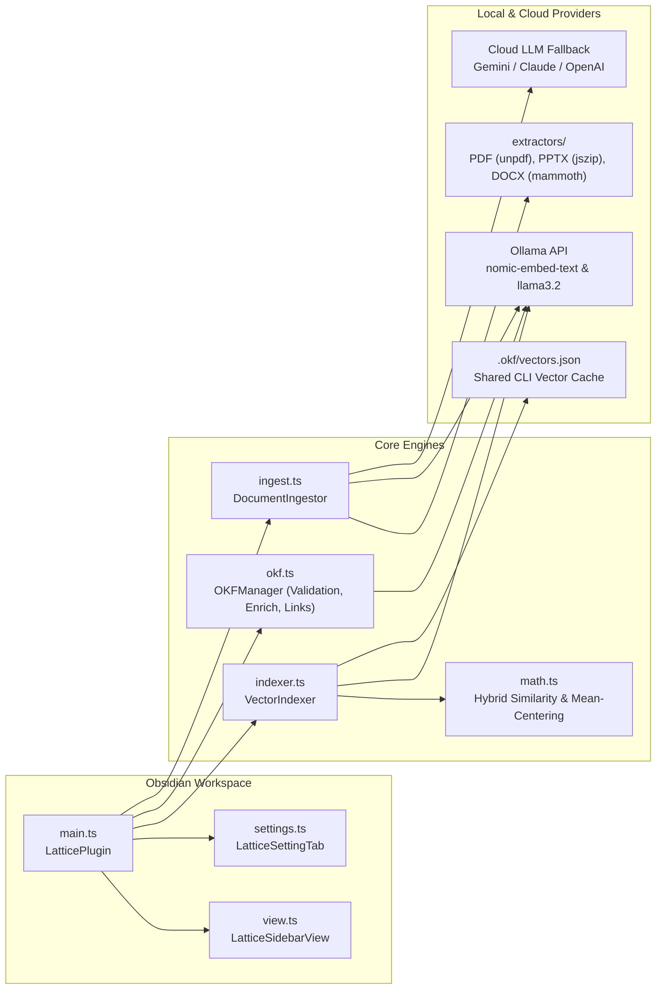

# Lattice Architecture & Hybrid Vector Engine

This document covers the internal architecture of **Lattice** (`obsidian-lattice`), its in-memory vector store, hybrid similarity ranking algorithm, and startup consistency engine.

---

## 1. System Overview & Module Map



| File | Responsibility |
| --- | --- |
| [`src/main.ts`](../src/main.ts) | Plugin lifecycle, command registration, debounced `vault.on("modify")` / `rename` / `delete` hooks, and status bar updates. |
| [`src/indexer.ts`](../src/indexer.ts) | Incremental `mtime`-based embedding pipeline, composite OKF embedding text builder, and `.okf/vectors.json` exporter. |
| [`src/math.ts`](../src/math.ts) | L2 vector normalization, corpus mean-centering (anisotropy correction), and hybrid semantic + lexical header scoring. |
| [`src/okf.ts`](../src/okf.ts) | Startup vault discovery, 5-field OKF validation, `Enrich OKF`, connected-note/full-vault conformance, `File → <folder>/`, and cross-linking. |
| [`src/ingest.ts`](../src/ingest.ts) | Drag-and-drop & file/folder/URL ingestion modal, 2-pass LLM synthesis, and Topic Hub integration. |
| [`src/extractors/`](../src/extractors/index.ts) | Zero-native-dependency document extractors for `.pdf` (`unpdf`), `.pptx` slides + speaker notes (`jszip`), and `.docx` (`mammoth`). |
| [`src/llm.ts`](../src/llm.ts) | Unified LLM synthesis client supporting local Ollama (`/api/generate`) and Cloud APIs (Gemini, Anthropic, OpenAI). |
| [`src/path-utils.ts`](../src/path-utils.ts) | Cross-machine `gdrive://` and vault-relative `resource` URI resolver. |

---

## 2. Composite Embedding String Construction

Rather than embedding raw YAML syntax, [`VectorIndexer.buildCompositeEmbeddingText`](../src/indexer.ts) constructs a weighted semantic string from each note's frontmatter and body (truncated to 8,000 characters):

```text
Title: <title>
Type: <type>
Summary: <description>
Tags: <tag1, tag2, ...>

<Markdown body without YAML frontmatter>
```

---

## 3. Anisotropy-Corrected Hybrid Ranking (`src/math.ts`)

Dense embedding models such as `nomic-embed-text` exhibit **cone anisotropy**: in a domain-focused vault, unrelated notes still share a baseline raw cosine similarity of `0.45–0.55`. Furthermore, relying purely on tags can fail if a note has incomplete or noisy tags.

Lattice solves both problems in [`findRelatedConcepts`](../src/math.ts) using a two-stage hybrid score:

1. **Corpus Mean-Centered Cosine Similarity ($S_{\text{sem}}$)**:
   - Computes the mean vector $\mu = \frac{1}{N}\sum_{i=1}^{N} v_i$ across all $N$ indexed notes in the vault.
   - Subtracts $\mu$ from both the query vector $q$ and candidate vector $v_i$, re-normalizes both to unit length, and computes their dot product:
     $$S_{\text{centered}}(q, v_i) = \frac{(q - \mu)}{\|q - \mu\|} \cdot \frac{(v_i - \mu)}{\|v_i - \mu\|}$$
   - The semantic score is $\max\bigl(S_{\text{raw}}(q, v_i),\, S_{\text{centered}}(q, v_i)\bigr)$.
2. **Additive Lexical Header Boost ($B_{\text{lex}}$)**:
   - Tokenizes `title`, `description`, and `tags` (removing stop words) and computes token overlap $O_{\text{title}} \in [0,1]$ and tag Jaccard overlap $O_{\text{tags}} \in [0,1]$.
   - Applies an **additive-only** boost controlled by `headerBoostWeight` ($w \in [0, 0.5]$, default `0.15`), gated on $S_{\text{sem}} \ge 0.20$:
     $$\text{Score}(q, v_i) = \min\Bigl(1.0,\; S_{\text{sem}} + w \cdot (0.65\,O_{\text{title}} + 0.35\,O_{\text{tags}})\Bigr)$$
   - Because the boost is additive and title-weighted, missing or noisy tags never penalize a strong prose/title match, and unrelated notes cannot be promoted by a tag alone.

---

## 4. Startup Discovery & Consistency Engine

On `onLayoutReady`, [`OKFManager.runStartupDiscovery`](../src/okf.ts) executes an in-memory pass (`<2ms`, zero LLM calls):
1. **Orphan Pruning**: Removes cached vectors whose markdown files were deleted or moved into `excludedFolders`.
2. **Dimension Consistency**: Detects the primary embedding dimension (e.g. `768` for `nomic-embed-text`) and prunes any stale records with mismatched dimensions.
3. **Dynamic `type ↔ folder` Discovery**: Starts with the 4 baseline routes (`note` → `notes`, `paper` → `sources/literature`, `topic` → `topics`, `project` → `projects`) and registers any additional folder-backed types present in the vault.
4. **Inbox Auto-Detection**: Resolves the active `inboxFolder` if the vault uses an existing convention (`inbox`, `Inbox`, `00_Inbox`, `Capture`, `Fleeting`).
