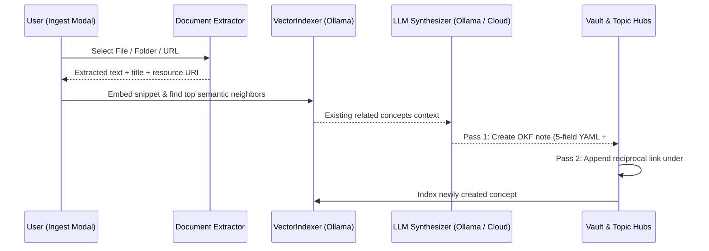

# Automated Knowledge Loader & Multi-Format Ingestion

The **Lattice Knowledge Loader** ([`src/ingest.ts`](../src/ingest.ts) and [`src/extractors/`](../src/extractors/index.ts)) transforms external documents, folders, and web URLs into conformant OKF concepts (`type: paper` or `type: topic`) and integrates them into your vault's knowledge graph.

---

## 1. Supported Formats & Extractors

All extractors run in-process inside Obsidian without external Python or binary dependencies:

| Format | Extractor Module | Extracted Content |
| --- | --- | --- |
| **PDF (`.pdf`)** | [`src/extractors/pdf.ts`](../src/extractors/pdf.ts) (`unpdf`) | Extracts page count, document title metadata, and full text across pages. Detects scanned/image-only PDFs automatically. |
| **PowerPoint (`.pptx`)** | [`src/extractors/pptx.ts`](../src/extractors/pptx.ts) (`jszip`) | Parses OpenXML `ppt/slides/slide*.xml` and `ppt/notesSlides/notesSlide*.xml` to extract both slide text and **Presenter Speaker Notes** per slide. |
| **Word (`.docx`)** | [`src/extractors/docx.ts`](../src/extractors/docx.ts) (`mammoth`) | Converts `.docx` paragraphs, headings, and lists into clean Markdown. |
| **Web URLs (`https://`)** | [`src/ingest.ts`](../src/ingest.ts) | Fetches HTML via Obsidian's `requestUrl` (bypassing CORS) and strips boilerplate scripts/navigation into readable prose. |
| **Batch Directories** | [`DocumentIngestor.ingestDirectory`](../src/ingest.ts) | Recursively scans a local folder for `.pdf`, `.pptx`, `.docx`, `.md`, and `.txt` files, skipping duplicates that already match an existing `resource` URI. |

---

## 2. Two-Pass Ingestion & Graph Integration Pipeline

### Pass 1: Structured Concept Synthesis
- Generates the 5-field YAML frontmatter (`type`, `title`, `description`, `tags`, `timestamp`) plus `resource: "<URI>"`.
- Produces a structured Markdown body with `# Summary`, `# Key learnings`, and `# Citations`.
- Supports **Local Ollama** (`llama3.2`), **Cloud APIs** (Google Gemini, Anthropic Claude, OpenAI), or **Auto** mode (tries local Ollama first and falls back to Cloud if offline).

### Pass 2: High-Precision Topic Hub Integration
- Queries the vector index using the hybrid similarity scorer (`strictAutoLink: true`).
- Only cross-links the new source into `## Related` and appends a reciprocal `- [Title](/path.md) — description` entry under `## Sources` in a `topics/` hub when verified by semantic + lexical overlap.

---

## 3. Cross-Machine Cloud Path Portability (`src/path-utils.ts`)

Large binary files (PDFs, slide decks) remain in their external storage folders rather than bloating the vault. [`resolvePortableResourceUri`](../src/path-utils.ts) normalizes local paths into portable `resource` URIs:

1. **Vault-Internal Files**: Converted to bundle-relative paths (`/sources/literature/paper.pdf`).
2. **Google Drive / Cloud Roots**: Paths inside `My Drive`, `Google Drive`, `OneDrive`, `Dropbox`, or `iCloudDrive` (or a custom root configured in Settings) are converted to `gdrive://...` URIs (e.g. `gdrive://Papers/sample.pdf`).
3. **Local Absolute Fallback**: Standard RFC 8089 `file:///C:/...` URI.
